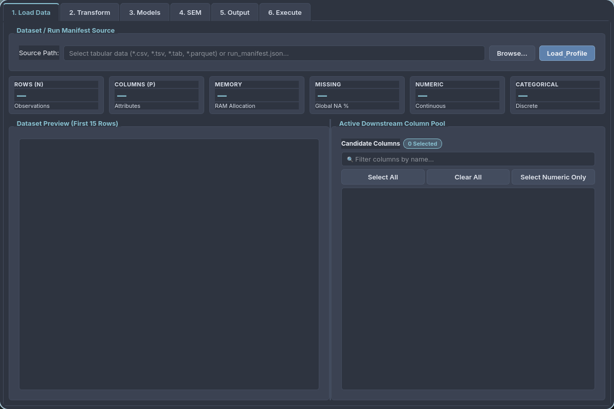

# METIS

Machine Evaluation & Tabular Inference System

## Application Preview

<p align="center">
  
</p>

**Overview**
METIS is an advanced academic research platform engineered for rigorous machine learning evaluation, cross-validated model tournaments, and structural equation modeling (SEM). Designed for high-throughput tabular data analysis, METIS integrates an interactive PySide6 graphical user interface with a robust, GUI-safe headless execution engine.

**Core Features**

- **Nested Cross-Validation Tournament**: Evaluates multiple regression and classification algorithms through strict inner and outer cross-validation folds, preventing data leakage while executing hyperparameter searches via randomized optimization. Supported estimators include Ridge, Lasso, ElasticNet, Bayesian Ridge, Logistic Regression, Random Forest, Extra Trees, HistGBDT, XGBoost, LightGBM, CatBoost, Support Vector Machines (SVR/SVC), Multi-Layer Perceptrons (MLP), and Stacking Super-Learners.

- **Structural Equation Modeling (SEM)**: Fits multivariate path structures, latent variables, and mediation effects using the `semopy` engine with bias-corrected non-parametric bootstrap confidence intervals or fallback OLS multivariate approximation.

- **Interactive GUI Workflow**: Features a dedicated six-tab PySide6 application interface covering data ingestion and profiling, in-memory leakage-safe transformations, model tournament partitioning, SEM topology, output customization, and live execution telemetry.

- **Automated Scientific Reporting**: Compiles self-contained HTML technical dossiers, publication-ready LaTeX booktabs tables, JSON manifests, and high-resolution diagnostic plots (including calibration curves, residual diagnostics, learning curves, and SHAP beeswarm attribution profiles).

**System Requirements & Dependencies**

- **Python**: Version 3.11 or higher.

- **Core Libraries**: `PySide6>=6.6.0`, `scikit-learn>=1.4.0`, `numpy>=1.26.0`, `pandas>=2.2.0`, `scipy>=1.12.0`, `matplotlib>=3.8.0`, `seaborn>=0.13.0`, `joblib>=1.3.0`, and `psutil>=5.9.0`.

- **Advanced Estimators & Interpretability**: `xgboost>=2.0.0`, `lightgbm>=4.3.0`, `catboost>=1.2.0`, `shap>=0.44.0`, and `semopy>=2.3.9`.

**Installation & Usage**

Clone the repository and install the package dependencies in your target environment:

```bash
uv sync
```

This creates/updates the project's virtual environment (`.venv`, managed by
`uv`) and installs all runtime dependencies plus the default development
dependency group (`pytest`, `ruff`) from the lockfile.

To install only the runtime dependencies (no dev tools):

```bash
uv sync --no-dev
```

**Reproducing an exact environment**

`pyproject.toml`/`uv.lock` use loose (`>=`) version bounds, appropriate
for general use but not sufficient to guarantee bit-for-bit reproducibility of
a specific analysis over time. The `uv.lock` file pins the exact, resolved
dependency versions for reproducible environments. To install the exact,
test-verified dependency versions instead:

```bash
uv sync --frozen   # install exactly what uv.lock resolves (no re-resolution)
uv run python -m pytest tests/ -v   # confirm the environment reproduces the test suite
```

Every pipeline run also writes its _actually installed_ package versions to
`run_manifest.json` (see `core.pipeline_runner.get_environment_metadata`) --
that manifest, not `uv.lock`, is the authoritative record of
what a specific past run used.

Run the full test suite (data loading, preprocessing, evaluation, modeling/leakage checks, interpretation, SEM, model-selection architecture, config schema, and full-pipeline integration):

```bash
uv run pytest tests/ -v
```

Launch the graphical user interface directly using the registered console script entry point:

```bash
uv run METIS
```

Or run directly through Python:

```bash
uv run python -m gui.main_window
```

**Author & Licensing**
Developed by AmirH. Mahmoudi. Licensed under the MIT License.
